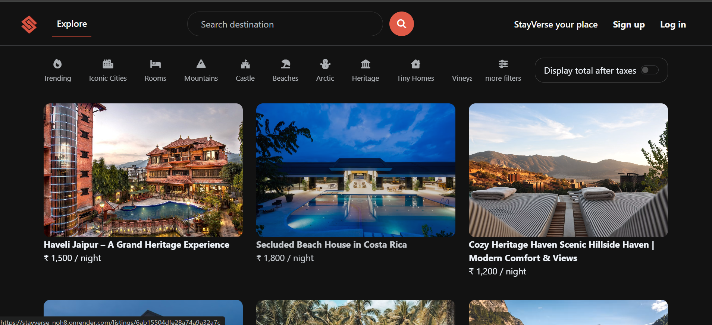
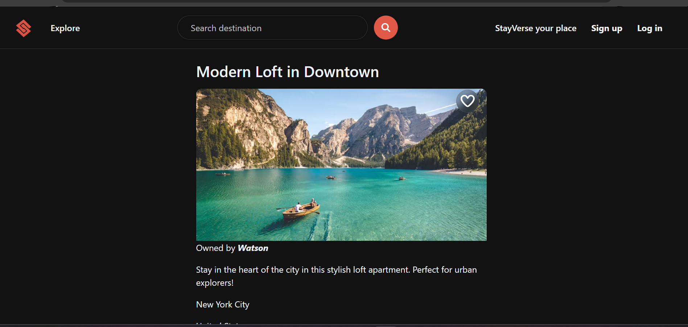
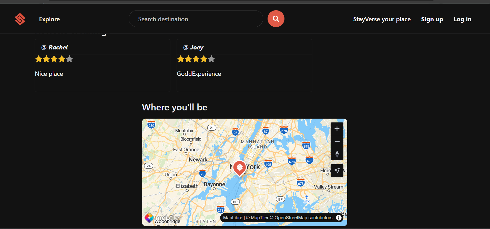

# StayVerse

A full-stack vacation listing platform where users can explore stays, host their own properties, and review places they have visited.

**Live demo:** https://stayverse-noh8.onrender.com/listings

## Screenshots

**Explore listings** with category filters and search



**Listing details** with host name and wishlist button



**Reviews, ratings and interactive map**



## Features

- Search listings by location and filter by category
- User authentication and authorization (sign up, log in, protected actions)
- Create and host your own property listings with image upload
- Add reviews and ratings
- Save listings to a wishlist
- Explore listings on interactive maps

## Tech stack

| Layer | Technology |
| --- | --- |
| Backend | Node.js, Express.js |
| Database | MongoDB, MongoDB Atlas |
| Front end | EJS templates, Bootstrap, CSS, JavaScript |
| Maps | MapTiler |
| Image storage | Cloudinary |

## Project structure

```
StayVerse/
├── controllers/   # request handling logic
├── models/        # Mongoose schemas
├── routes/        # Express routes
├── views/         # EJS templates
├── public/        # static assets (CSS, client-side JS)
├── utils/         # helper utilities
├── init/          # database seed data
├── middleware.js  # auth and validation middleware
├── schema.js      # request validation schemas
├── cloudConfig.js # Cloudinary configuration
└── app.js         # app entry point
```

## Run it locally

1. Clone the repository and install dependencies:

   ```bash
   git clone https://github.com/TanishaJaiswal-web/StayVerse.git
   cd StayVerse
   npm install
   ```

2. Create a `.env` file in the project root. Use the variable names your code reads (check `app.js` and `cloudConfig.js`):

   ```
   ATLASDB_URL=<your MongoDB Atlas connection string>
   SECRET=<session secret>
   CLOUD_NAME=<Cloudinary cloud name>
   CLOUD_API_KEY=<Cloudinary API key>
   CLOUD_API_SECRET=<Cloudinary API secret>
   MAP_TOKEN=<MapTiler API key>
   ```

3. (Optional) Seed the database with sample listings:

   ```bash
   node init/index.js
   ```

4. Start the server and open http://localhost:3000:

   ```bash
   node app.js
   ```

## What I learned

Building StayVerse helped me understand how the front end, backend, database, authentication, APIs, image storage and location-based features work together in a real-world application.

## Author

**Tanisha Jaiswal**
GitHub: [TanishaJaiswal-web](https://github.com/TanishaJaiswal-web) · LinkedIn: [tanisha-jaiswal](https://www.linkedin.com/in/tanisha-jaiswal-090ab427a/)
